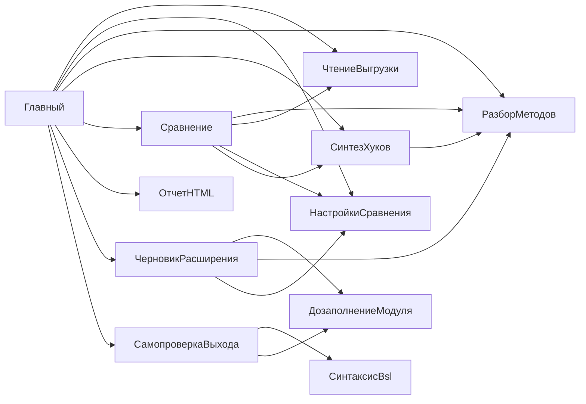

# Поток выполнения typovaya-up

Точка входа: `src/Главный.os` → `Выполнить_(АргументыКоманднойСтроки)`.

## 1. CLI и валидация

1. `РазобратьАргументы` → структура `source`, `vendor`, `settings`, `out`, `extension`, `prefix`,
   `noReport`, `reportOnly`, `noSyntax`, `syntaxLimit`, формы, ibcmd, `errors`.
2. `--только-отчет`: незаданные пути берутся из `summary.json.meta` готового `--выход`
   (`ДополнитьИзСводки`); несовместим с `--без-отчета`.
3. Код выхода **1** — справка/ошибки аргументов; **2** — нет папок или `out` внутри выгрузки; **3** — отказ ibcmd.
4. Динамически подключаются сценарии из `src/*.os` через `ЗагрузитьСценарий`.
5. Прогресс: `НачатьШаг` → строка `[шаг N] … — ЧЧ:ММ:СС` в консоль и лог; секунды копятся в `Замеры` → `timings`.

## 2. Чтение выгрузок (`ЧтениеВыгрузки`)

- `ПрочитатьВыгрузку(Корень, Лог)` → структура: `Корень`, `Имя`, `Версия`, `Модули` (`Соответствие` относительный путь → полный путь `.bsl`).
- Инвариант: только модули вне `\Forms\` и `\Templates\`.
- Ошибки: отсутствие `Configuration.xml` — запись в `Лог`, пустой список модулей.

## 3. Настройки merge (`НастройкиСравнения`)

- Опционально `ПрочитатьНастройки(path, Лог)` → `Пути` (Соответствие модульных путей), счётчики сопоставления.
- Если пересечение периметра с выгрузками = 0 — предупреждение, сравнение всех общих `.bsl`.
- `ТипПоКаталогу` — маппинг `CommonModules` → `CommonModule` и т.д. (для черновика и отчёта).

## 4. Сравнение (`Сравнение`)

```
СравнитьВыгрузки(Исходная, Поставщик, Периметр, Лог)
  └─ для каждого пути: СравнитьМодуль
       ├─ only_source / only_vendor / identical / cosmetic (ранние выходы)
       ├─ РазобратьМодуль × 2
       ├─ СопоставитьМетодыПоставщика → Синтез.ПредложитьХук
       ├─ ДобавитьМетодыТолькоИсходной
       └─ КлассифицироватьКорзинуМодуля → bucket auto|manual
```

**Структура модуля:** `path`, `type`, `object`, `bucket`, `reason`, `sourceText`, `vendorText`, `outsideDiffers`, `methods[]`, `counts`.

**Структура метода:** `name`, `kind`, `status` (same|changed|added|removed), `hook`, `hookDecision`, `hookBody`, тексты, `explain`.

## 5. Синтез хуков (`СинтезХуков`)

- Вход: нормализованные тела (без объявлений).
- Выход: `decision` (skip|auto|manual), `hook`, `reason`, `hookBody`.
- Порядок эвристик: префикс/суффикс → вставки → `ПродолжитьВызов` → LCS/patience → `&Вместо` → manual.
- `&ИзменениеИКонтроль`: сигнатура один раз как в типовой и вне `#Удаление`; блоки охватывают `// УП_начало`…`// УП_конец`;
  `// АПК:` не УП; типовое тело байт в байт; директивы с начала строки.
- Ограничение: LCS-окно > ~400k ячеек → грубый diff (см. комментарии в модуле).

## 6. Отчёт (`ОтчетHTML`) — обычный режим

- `СобратьСводку(Модули, Мета)` → JSON-совместимая структура counts + hooks + списки путей (+ `meta` с путями выгрузок).
- Сразу пишется `summary.json` (нужен для `--только-отчет` и `--без-отчета`).
- Если не `--без-отчета`: `ЗаписатьHtml` → `razbor_moduley.html`.
- Инвариант: идентичные модули в HTML не детализируются (только счётчик).

### 6a. Режим `--только-отчет`

Сравнение → `СобратьСводку` → `ЗаписатьHtml` → `report_only_log.txt` (+ замеры в лог).
`extension`/`restored`/`self_check.json`/`summary.json` не перезаписываются.

## 7. Черновик и restored (`ЧерновикРасширения`)

```
Записать(Модули, КореньИсходной, Выход, …, Лог)
  ├─ extension/, restored/ (очистка)
  ├─ для bucket in (auto, manual): модули с ИдётВРасширение
  │     ├─ ОтрисоватьМетод → .bsl с &Перед/&После/… (dedup объявлений)
  │     ├─ Дозаполнение: УП_ rename только в #Вставка + хелперы
  │     └─ ВосстановитьТекст → restored/
  ├─ XmlОбъекта: InternalInfo из УП (кроме CommonModule/Language/CommonCommand)
  ├─ ЗаимствоватьЯзык
  └─ XmlКонфигурации + extension_meta/Configuration_InternalInfo.xml
       (ClassId платформенные; ObjectId e1000001-* → детерминированные)
```

Замеры внутри шага: `helpers`, `restored` выделяются из `extension`.

**Пропуски:** `Ext\…` (корень), `only_source`, нестандартные пути, методы без авто-хука в manual-модулях частично.

## 8. Самопроверка (`СамопроверкаВыхода` + `СинтаксисBsl`)

- `ПроверитьКаталогВыхода` → `self_check.json`.
- Категории: локальные вызовы (whitelist глобального контекста bsparser), целостность ИК,
  шаблонные UUID, `invalid_class_id`, `duplicate_method_definitions`, `syntax_errors` (bsparser;
  `--без-синтаксиса` / `--синтаксис-лимит`), вызовы удалённых методов в restored, счётчик `manual`.
- Замер `syntax` выделяется из `selfCheck`.

## 9. Завершение

- `timings` в `summary.json`, `log.txt`, код **0** при успехе.
- Побочные эффекты: только каталог `out` (и подкаталоги), входные выгрузки не изменяются.

## 10. Сборка полной основной конфигурации (вне утилиты)

`restored` — только изменённые модули. Для загрузки в ИБ: копия выгрузки УП → `up-typical`, поверх — `restored`
(см. README). Затем расширение из `extension/`.

## Зависимости модулей


