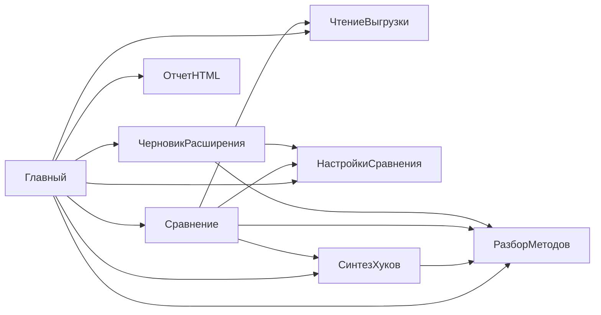

# Поток выполнения typovaya-up

Точка входа: `src/Главный.os` → `Выполнить_(АргументыКоманднойСтроки)`.

## 1. CLI и валидация

1. `РазобратьАргументы` → структура `source`, `vendor`, `settings`, `out`, `extension`, `prefix`, `errors`.
2. Код выхода **1** — справка/ошибки аргументов; **2** — нет папок или `out` внутри выгрузки.
3. Динамически подключаются сценарии из `src/*.os` через `ЗагрузитьСценарий`.

## 2. Чтение выгрузок (`ЧтениеВыгрузки`)

- `ПрочитатьВыгрузку(Корень, Лог)` → структура: `Корень`, `Имя`, `Версия`, `Модули` (`Соответствие` относительный путь → полный путь `.bsl`).
- Инвариант: только модули вне `\Forms\` и `\Templates\`.
- Ошибки: отсутствие `Configuration.xml` — запись в `Лог`, пустой список модулей.

## 3. Настройки merge (`НастройкиСравнения`)

- Опционально `ПрочитатьНастройки(path, Лог)` → `Пути` (Соответствие модульных путей), счётчики сопоставления.
- Если пересечение периметра с выгрузками = 0 — предупреждение, сравнение всех общих `.bsl`.
- `ТипПоКаталогу` — маппинг `CommonModules` → `CommonModule` и т.д. (для черновика и отчёта).

## 4. Сравнение (`Сравнение`)

```
СравнитьВыгрузки(Исходная, Поставщик, Периметр, Лог)
  └─ для каждого пути: СравнитьМодуль
       ├─ only_source / only_vendor / identical / cosmetic (ранние выходы)
       ├─ РазобратьМодуль × 2
       ├─ СопоставитьМетодыПоставщика → Синтез.ПредложитьХук
       ├─ ДобавитьМетодыТолькоИсходной
       └─ КлассифицироватьКорзинуМодуля → bucket auto|manual
```

**Структура модуля в массиве результатов:** `path`, `type`, `object`, `bucket`, `reason`, `sourceText`, `vendorText`, `outsideDiffers`, `methods[]`, `counts`.

**Структура метода:** `name`, `kind`, `status` (same|changed|added|removed), `hook`, `hookDecision`, `hookBody`, тексты, `explain`.

## 5. Синтез хуков (`СинтезХуков`)

- Вход: нормализованные тела (без объявлений).
- Выход: `decision` (skip|auto|manual), `hook`, `reason`, `hookBody`.
- Порядок эвристик: префикс/суффикс → вставки → `ПродолжитьВызов` → LCS/patience → `&Вместо` → manual.
- Ограничение: LCS-окно > ~400k ячеек → грубый diff (см. комментарии в модуле).

## 6. Отчёт (`ОтчетHTML`)

- `СобратьСводку(Модули, Мета)` → JSON-совместимая структура counts + hooks + списки путей.
- `ЗаписатьОтчет` → `razbor_moduley.html` (шаблон + встроенный JSON), `summary.json`.
- Инвариант: идентичные модули в HTML не детализируются (только счётчик).

## 7. Черновик и restored (`ЧерновикРасширения`)

```
Записать(Модули, КореньИсходной, Выход, …, Лог)
  ├─ extension/, restored/ (очистка)
  ├─ для bucket in (auto, manual): модули с ИдётВРасширение
  │     ├─ ОтрисоватьМетод → .bsl с &Перед/&После/…
  │     └─ ВосстановитьТекст → restored/
  ├─ XmlОбъекта: InternalInfo из УП (кроме CommonModule/Language/CommonCommand)
  ├─ ЗаимствоватьЯзык
  └─ XmlКонфигурации + extension_meta/Configuration_InternalInfo.xml
```

**Счётчики итога:** `objects`, `modules`, `methods`, `hooks`, `newMethods`, `restored`, `skippedRoot`, `commands`, …

**Пропуски:** `Ext\…` (корень), `only_source`, нестандартные пути, методы без авто-хука в manual-модулях частично.

## 8. Завершение

- `log.txt`, код **0** при успехе.
- Побочные эффекты: только каталог `out` (и подкаталоги), входные выгрузки не изменяются.

## Зависимости модулей


