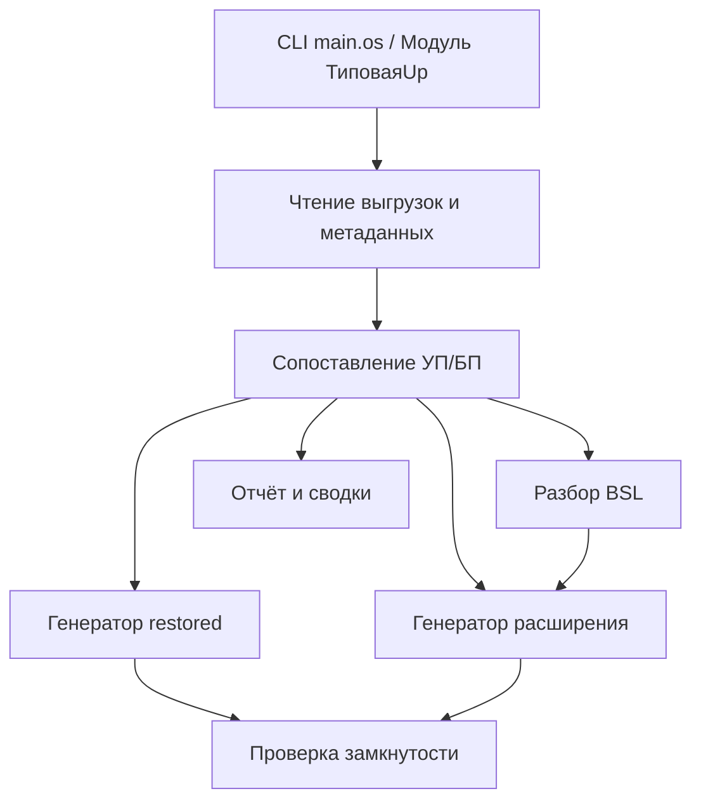

# PLAN_V2: typovaya-up как пакет OneScript

Дата: 2026-11-22. Ветка `cursor/configdump-supplement-6036` (PR #32). Эталон рабочей логики: `typovaya-up/src/*.os` (не переписывать до поэтапной миграции). Каркас пакета: `typovaya-up/v2/`.

Стандарты пакета: [yellow-hammer/skills-onescript](https://github.com/yellow-hammer/skills-onescript) (`packagedef`, `src/Модули`, `src/Классы`, `src/internal`, `tasks/`, OneUnit).

Платформа целевой конфигурации: **8.5.1.1150**, формат выгрузки **2.21** (как в `tests/run_tests.sh` и фикстурах).

---

## 1. Цель v2

Перевести утилиту с набора сценариев (`ЗагрузитьСценарий` из `Главный.os`) в **opm-пакет** с явными слоями, тестируемыми правилами домена и CLI `opm`/ `oscript` без изменения семантики эталона, пока не пройдут регрессионные сравнения «старый vs новый» на одних входах.

Два выхода генератора (инвариант домена):

| Каталог | Назначение |
|---------|------------|
| `restored/` | Основная конфигурация: типовое из БП, Form.xml дословно, дыры — заглушки/метаданные |
| `extension/` | Расширение `УП_Доработки` (`NamePrefix` `УП_`): только доработки УП |

---

## 2. Архитектура слоёв

| Слой | Класс v2 (каркас) | Эталон v1 |
|------|-------------------|-----------|
| CLI, аргументы, оркестрация | `Модули/ТиповаяUp.os`, `src/main.os` | `Главный.os`, `ПрименитьХуки.os` |
| Чтение выгрузок | `Классы/ЧтениеВыгрузки.os` | `ЧтениеВыгрузки.os` |
| Настройки merge / периметр | `Классы/НастройкиСравнения.os` | `НастройкиСравнения.os` |
| Индекс метаданных, ConfigDumpInfo | `Классы/МетаданныеКонфигурации.os` | `ConfigDumpInfoБп.os`, `ВозвратМетаданныхФормБп.os`, … |
| Сопоставление модулей | `Классы/СопоставлениеВыгрузок.os` | `Сравнение.os` |
| Разбор BSL (фасад) | `Классы/РазборBsl.os` | `РазборМетодов.os`, `РазборAST.os`, `СинтаксисBsl.os` |
| Лексика / препроцессор-обёртки | `internal/Классы/ЛексическийРазборМодуля.os` | `РазборМетодов.os`, `КонтрактМетода.os` |
| Обертка lead-tools bsparser | `internal/Классы/ОберткаBsparser.os` | `vendor/bsparser`, `РазборAST.os` |
| Синтез хуков | `Классы/СинтезХуков.os` | `СинтезХуков.os`, `ПередПослеВИиК.os` |
| Дозаполнение / CAC | `Классы/ДозаполнениеМодуля.os` | `ДозаполнениеМодуля.os`, `ДозаполнениеМодуля` + см. `CALLREWRITE_DEBT.md` |
| Черновик extension + restored | `Классы/ГенераторРасширения.os` | `ЧерновикРасширения.os` |
| Restored: формы, заготовки, XML | `Классы/ГенераторRestored.os` | `ФормыRestored.os`, `ЗаготовкиОбъектовБп.os`, `ОбъектыТолькоУп.os`, … |
| Формы (программный слой УП) | `Классы/ФормыРасширения.os` | `ФормыПрограммныйСлойУп.os`, `ЗаимствованиеПолейСписков.os`, … |
| Отчёт HTML / JSON | `Классы/Отчет.os` | `ОтчетHTML.os` |
| Самопроверка выхода | `Классы/СамопроверкаВыхода.os` | `СамопроверкаВыхода.os` |
| Замкнутость (ModCheck этап 1) | `Классы/ПроверкаЗамкнутости.os` | `ПроверкаЗамкнутости.os` |
| ModCheck цикл / ibcmd (опц.) | `Классы/КонвейерModCheck.os` | `ИтерацияModCheck.os`, `ИмпортModCheck.os`, … |
| Кэш compare / bsparser | `internal/Классы/КэшПроверок.os` | `КэшПроверок.os` |
| Правила домена (константы, ID) | `Модули/ПравилаДомена.os` | размазано по `docs/`, `PLAN_MODCHECK.md` |

Вспомогательные сценарии v1 (перенос по мере фаз): `АнализФорм`, `ИмпортРасширения*`, `РазборЛогаИмпорта`, `ОбратнаяСборка*`, `ПочинитьFormXml*`, … — в v2 сгруппировать под `ФормыРасширения`, `КонвейерModCheck`, `МетаданныеКонфигурации`.

---

## 3. Каталог правил домена (тестируемые ID)

| ID | Правило | Источник / проверка |
|----|---------|---------------------|
| **R-DOM-001** | Утилита делает типовой УП за счёт БП; доработки УП — только в расширении с префиксом `УП_` | `PLAN.md`, `FLOW.md`; e2e `run_tests.sh` |
| **R-DOM-002** | `restored`: код БП дословно; `Form.xml` = БП дословно, формы не режутся | `PLAN_MODCHECK.md`, `ФормыRestored.os`, `test_forms_restored.os` |
| **R-DOM-003** | Объект есть в УП → состав УП + недостающие реквизиты/ТЧ из БП; нет в УП → заглушка или полные метаданные (Task, адресация) | `ЗаготовкиОбъектовБп.os`, `test_task_full_metadata.os` |
| **R-DOM-004** | `DefinedType` как в УП; при одном `uuid` и разных именах — имя БП, переименование ссылок в расширении | `test_defined_type_from_up.os` |
| **R-DOM-005** | Уникальность **всех** `InternalInfo` / `xr:GeneratedType` (`TypeId`, `ValueId`, `ObjectId` где применимо) **по всей конфигурации** (не только `DefinedTypes/`). Ошибка загрузки вида: *«Тип порождаемый объектом InternalInfo содержит не уникальное значение …»* | v1: частично `DefinedTypeDuplicateUuid` в modcheck; **v2: расширить** в `ПроверкаЗамкнутости` |
| **R-DOM-006** | Код УП только в `extension/`; хуки `&ИзменениеИКонтроль`; `&Вместо` только обёртка с `ПродолжитьВызов` | `СинтезХуков.os`, `test_hooks.os`, `БезопасностьПереноса.os` |
| **R-DOM-007** | Заимствованные формы расширения: `Form.xml` как БП без стандартных команд; реквизиты/элементы/команды УП — в `ПриСозданииНаСервере` через `ЭтаФорма` | `ФормыПрограммныйСлойУп.os`, `test_programmatic_forms.os` |
| **R-DOM-008** | Правила замкнутости и закрытия дыр — **только в генераторе**; ручные правки `restored`/`extension` запрещены; проверки **одинаковы** для БП/УП/restored (без «подгонки под нули») | `PLAN_MODCHECK.md`, `ПроверкаЗамкнутости.os`, `test_modcheck_closure.os` |
| **R-DOM-009** | Платформа **8.5.1.1150**, выгрузка **2.21** | `Configuration.xml` фикстур, `run_tests.sh` |
| **R-DOM-010** | Самопроверка выхода: ClassId, дубли методов, синтаксис bsparser, CAC vs main, локальные вызовы | `СамопроверкаВыхода.os`, `self_check.json` |

Правила **R-DOM-005** и **R-DOM-008** в v2 оформить как API `ПравилаДомена` + unit-тесты на фикстурах (в т.ч. синтетический duplicate `TypeId`).

---

## 4. bsparser (lead-tools) vs дописываем сами

Источник: vendored `typovaya-up/vendor/bsparser` (коммит `82704fe0…`, MIT), в перспективе — opm-зависимость или git submodule; пакет **не** в hub OneScript под именем `bsl-parser`.

### 4.1. Что даёт bsparser (полный разбор / AST)

- Лексер/парсер BSL: объявления методов, аннотации (`&ИзменениеИКонтроль`, `&Перед`, …), директивы компиляции, **инструкции препроцессора** в грамматике: `#Если`, `#Иначе`, `#Область`, `#Вставка`, `#Удаление`, `#Использовать` (см. `ObjectModule.bsl` vendored).
- `Разобрать(Текст)` → дерево, `ТаблицаТокенов()`, `ТаблицаОшибок()`.
- Точные позиции сигнатуры и тела (1-based), отпечатки тел без пробелов/комментариев (`РазборAST.os`).
- Синтаксическая проверка модулей `extension`/`restored` (`СинтаксисBsl.os`, `СамопроверкаВыхода`).
- Whitelist глобального контекста: `vendor/bsparser/scope/global`.

### 4.2. Что **не** покрывает bsparser (оставляем/дописываем в v2)

| Задача | Реализация v1 | v2 |
|--------|---------------|-----|
| Быстрый отбор границ методов без полного AST | `РазборМетодов.os`: `//` вне строк, `""`, многострочная сигнатура, маркеры `КонецПроцедуры` только как оператор | `ЛексическийРазборМодуля` (internal), тесты из `test_parse.os` |
| Обёртки `#Вставка`/`#Удаление` **вокруг** целого метода (не внутри тела) | `НайтиОбёрткуПрепроцессора` в `РазборМетодов` | тот же слой; bsparser видит директивы внутри AST, но эвристика «обёртка метода» — своя |
| Проверка готового хука ИК: проекции «типовая/итог», парность директив, сигнатура не в `#Удаление` | `РазборAST.ПроверитьХук` (гибрид: строки + bsparser) | `РазборBsl.ПроверитьХук` |
| Синтез `#Вставка`/`#Удаление`, LCS, маркеры `// УП_начало` | `СинтезХуков.os` | `СинтезХуков` |
| Diff «только комментарии/АПК» | Префильтр текста + отпечатки AST | `СопоставлениеВыгрузок` |
| Новый BSL (`ВызватьИсключение` с двумя параметрами) | Замена на `ПараметрыИсключения` перед разбором (`РазборAST`) | `ОберткаBsparser.ПодготовитьТекст` |
| Семантика `#Если` в **теле** при лексическом разбиении | Не интерпретируется (документировано в `API_REFERENCE`) | без изменения семантики до отдельной фазы |
| CallRewrite вызовов, динамические вызовы | `БезопасностьПереноса`, долг `CALLREWRITE_DEBT.md` | фаза 4+ |

**Стратегия v2:** фасад `РазборBsl` = маршрут `lexical` | `ast` (аналог `--parser old|bsparser`); AST через `ОберткаBsparser`; лексика — порт `РазборМетодов` без удаления эталона в `src/`.

---

## 5. Маппинг `src/*.os` → классы v2

Полный список модулей v1 — 69 файлов. Сводка по доменам (детальные сигнатуры — `docs/API_REFERENCE.md`):

| v1 модуль | v2 назначение |
|-----------|----------------|
| `Главный` | `main.os` + `ТиповаяUp.Выполнить` |
| `ЧтениеВыгрузки` | `ЧтениеВыгрузки` |
| `НастройкиСравнения` | `НастройкиСравнения` |
| `Сравнение` | `СопоставлениеВыгрузок` |
| `РазборМетодов`, `РазборAST`, `СинтаксисBsl`, `КонтрактМетода` | `РазборBsl` + `ЛексическийРазборМодуля` + `ОберткаBsparser` |
| `СинтезХуков`, `ПередПослеВИиК` | `СинтезХуков` |
| `ДозаполнениеМодуля`, `ДублиМетодовОсновной` | `ДозаполнениеМодуля` |
| `ЧерновикРасширения` | `ГенераторРасширения` |
| `ФормыRestored`, `ВосстановитьFormБпДословно`, `ПостобработкаRestoredForm`, `ЗаготовкиОбъектовБп`, `Заглушки*`, `ОбъектыТолькоУп`, `ПереносОбъектовУп`, `ДогрузитьCommonPicture`, `ДозаготовкиБыстро`, `ДополненияПоЛогуImport`, `ВосстановитьМетаданныеИзЭкспорта`, `СинхронизироватьСсылкиФорм`, `ConfigDumpInfoБп` | `ГенераторRestored` (+ частично `МетаданныеКонфигурации`) |
| `ФормыПрограммныйСлойУп`, `ЗаимствованиеПолейСписков`, `ПрименитьЗаимствование*`, `ПочинитьФормыРасширения`, `ПеречислитьСтандартныеКомандыФорм`, `ПроверкаXmlForm`, `ПроверкаFormXdto`, `АнализФорм`, `ПревьюРеквизитовФормы`, `ПереносРеквизитовФормы`, `ПрименитьМетаданныеФорм` | `ФормыРасширения` |
| `ОтчетHTML` | `Отчет` |
| `СамопроверкаВыхода`, `ПроверкаСкелетаРасширения`, `ПроверкаСсылокКонфигурации`, `ПроверкаФорм`, `ПроверкаАрности` | `СамопроверкаВыхода` (+ специализированные internal) |
| `ПроверкаЗамкнутости`, `ЗапускПроверкаЗамкнутости` | `ПроверкаЗамкнутости` |
| `ИтерацияModCheck`, `ИмпортModCheck`, `ЦиклВалидацииИмпорта`, `ГейтПередИмпортом`, `ИмпортРасширения*`, `ЗапускShell` | `КонвейерModCheck` (opt-in, не в MVP пакета) |
| `КэшПроверок` | `КэшПроверок` (internal) |
| `ОбратнаяСборка`, `ОбратнаяСборкаЗапуск` | отдельная команда CLI (фаза позже) |
| `ПрименитьХуки`, `ПереносСигнатур`, `БезопасностьПереноса` | `СинтезХуков` / `ДозаполнениеМодуля` |
| `РазборЛогаИмпорта`, `СводкаОшибокImport` | `МетаданныеКонфигурации` / `КонвейерModCheck` |
| `IbcmdРасширения` | `КонвейерModCheck` |

---

## 6. Поэтапная миграция и критерии готовности

| Фаза | Содержание | Критерий готовности |
|------|------------|---------------------|
| **M0** (текущий коммит) | `PLAN_V2.md`, каркас `v2/`, smoke-тест, `src/` не тронут | `opm run test` в `v2/` зелёный; `tests/run_tests.sh` без регрессии |
| **M1** | Порт `ЧтениеВыгрузки`, `НастройкиСравнения`, CLI-аргументы (без генерации) | Паритет структур с v1 на фикстурах; `test_settings.os` логика дублируется в v2 |
| **M2** | `РазборBsl` + тесты `test_parse`, `test_ast*` | Бит-в-бит отпечатки/границы методов vs v1 |
| **M3** | `СопоставлениеВыгрузок` + `СинтезХуков` | `summary.json` / buckets совпадают с v1 на `fixtures/UP+BP` (`diff` пустой по `extension` для `--parser old` и `bsparser`) |
| **M4** | `ГенераторРасширения` + `ГенераторRestored` | Полный прогон: `diff -qr` каталогов выхода v1 и v2 на тех же `-и/-п/-н/-в` |
| **M5** | `ПроверкаЗамкнутости` + **R-DOM-005** | Все `test_modcheck_*` + новые фикстуры duplicate `TypeId`; метрика `counts` не хуже v1 |
| **M6** | Формы, ModCheck ibcmd, обратная сборка | Opt-in; не блокирует переключение CLI по умолчанию |
| **M7** | Переключение: `v2` — основной entry; `src/Главный.os` — thin wrapper | CI использует пакет; README обновлён |

**Регрессия «старый vs новый»:** для M3–M5 обязательный скрипт (будущий `v2/tests/compare_with_v1.os`): одинаковые входы → сравнение `extension/`, `restored/`, `summary.json`, `self_check.json`, `modcheck_closure.json` (допускаются только явно задокументированные отличия).

---

## 7. Риски

| Риск | Митигация |
|------|-----------|
| bsparser [RIP], отставание от BSL 8.5.1 | Vendored pin; fallback lexical route; список конструкций в `ОберткаBsparser` |
| Глобальные имена классов OneScript | Префикс `ТиповаяUp*` в публичных классах |
| Дублирование логики v1/v2 на переходный период | Запрет правок семантики в `src/` кроме bugfix; перенос только копированием с тестом паритета |
| InternalInfo collisions при склейке УП+БП | R-DOM-005 в modcheck до ibcmd; генератор не копирует слепо дубли `TypeId` |
| Сложность форм / dynlist | Остаётся `manual` с причиной; `ЗапросыДинСписков.os` — поздняя фаза |
| CallRewrite | Явно вне MVP (`CALLREWRITE_DEBT.md`) |

---

## 8. Связанные документы

- [PLAN.md](PLAN.md), [PLAN_MODCHECK.md](PLAN_MODCHECK.md), [FLOW.md](FLOW.md), [API_REFERENCE.md](API_REFERENCE.md), [CALLREWRITE_DEBT.md](CALLREWRITE_DEBT.md)
- Каркас: [../v2/README.md](../v2/README.md)
- Эталон CI: `tests/run_tests.sh`